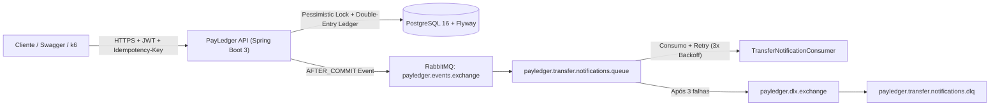

# PayLedger — Digital Wallet & Immutable Financial Ledger API

API de carteira digital e ledger financeiro imutável construída em **Java 21 + Spring Boot 3**, projetada com foco em **consistência transacional, idempotência, controle de concorrência, mensageria resiliente e testes reais com Testcontainers**.

---

## Arquitetura



---

## Decisões Técnicas & Trade-offs

| Desafio | Decisão adotada | Por quê? |
| --- | --- | --- |
| **Precisão monetária** | `BigDecimal` + `NUMERIC(19,2)` + `RoundingMode.HALF_EVEN` | Elimina erros de ponto flutuante (`double`/`float`) em cálculos financeiros. |
| **Auditoria de saldo** | `wallets` (saldo atual) + `ledger_entries` (partida dobrada imutável) | Leitura rápida de saldo combinada com histórico auditável onde nunca há `UPDATE`/`DELETE`. |
| **Cobrança dupla / Retries de rede** | Header `Idempotency-Key` + constraint `UNIQUE` no PostgreSQL | Reenvios da mesma intenção retornam a transação original sem debitar novamente. |
| **Race condition & Deadlock** | `PESSIMISTIC_WRITE` (`SELECT ... FOR UPDATE`) ordenado pelo menor `UUID` | Impede saldo negativo sob alta concorrência e elimina deadlocks em transferências cruzadas (`A -> B` e `B -> A`). |
| **Consistência entre DB e Fila** | `@TransactionalEventListener(phase = AFTER_COMMIT)` | Só publica o evento no RabbitMQ após o commit confirmado no PostgreSQL. |
| **Resiliência de notificações** | Retry exponencial (3 tentativas) + Dead Letter Queue (DLQ) | Falhas externas não quebram a transferência nem perdem eventos. |
| **Performance JPA** | `Persistable<UUID>` + `open-in-view: false` + `@EntityGraph` | Evita `SELECT` extra antes de `INSERT` e elimina consultas N+1 no extrato. |
| **Padronização de erros** | `@RestControllerAdvice` com `ProblemDetail` (RFC 7807) | Contrato consistente de erros (`400`, `401`, `404`, `409`, `422`). |

---

## Stack
- **Java 21** (Records, Pattern Matching) & **Spring Boot 3.4**
- **PostgreSQL 16** + **Flyway** (`ddl-auto: validate`)
- **Spring Security** + **JWT** (stateless, BCrypt)
- **RabbitMQ 3.13** (Exchange, Retry com backoff exponencial e DLQ)
- **Springdoc OpenAPI / Swagger UI**
- **JUnit 5**, **Mockito**, **Testcontainers** e **k6**
- **Docker** (multi-stage build com usuário não-root) & **GitHub Actions CI**

---

## Como rodar localmente

### 1. Suba PostgreSQL e RabbitMQ
```bash
docker compose up -d
```

### 2. Rode a aplicação
```bash
mvn spring-boot:run
```

### 3. Acesse os painéis
- **Swagger UI:** http://localhost:8080/swagger-ui.html
- **Health Check:** http://localhost:8080/actuator/health
- **RabbitMQ Management:** http://localhost:15672 (usuário `payledger` / senha `payledger_secret`)

---

## Endpoints

| Método | Rota | Auth | Descrição |
| --- | --- | --- | --- |
| `POST` | `/api/v1/auth/register` | Público | Cadastra usuário e cria carteira com saldo `0.00` |
| `POST` | `/api/v1/auth/login` | Público | Autentica e retorna JWT |
| `GET` | `/api/v1/wallets/me` | JWT | Consulta carteira e saldo atual |
| `POST` | `/api/v1/wallets/deposit` | JWT + `Idempotency-Key` | Deposita valor e registra crédito no ledger |
| `POST` | `/api/v1/transfers` | JWT + `Idempotency-Key` | Transfere com lock anti-deadlock e partida dobrada |
| `GET` | `/api/v1/wallets/me/statement` | JWT | Extrato paginado (`direction`, `from`, `to`, `page`, `size`) |

---

## Testes

### Testes Unitários + Integração & Concorrência (Testcontainers)
Com o Docker rodando:
```bash
mvn test
```
O [PayLedgerIntegrationTest.java](src/test/java/com/payledger/PayLedgerIntegrationTest.java) sobe um **PostgreSQL 16 real em container**, executa as migrations do Flyway e valida:
- Fluxo E2E completo (registro → depósito → transferência → extrato)
- Idempotência sob requisições duplicadas
- **Concorrência real:** 10 threads simultâneas tentando transferir `20.00` de uma carteira com saldo `100.00` — provando que exatamente **5** passam, **5** recebem `422` e o saldo nunca fica negativo.

### Demonstração de Retry + DLQ no RabbitMQ
Envie uma transferência contendo `[FAIL_NOTIFICATION]` no campo `description`. O consumer executará 3 tentativas com backoff exponencial e encaminhará a mensagem JSON intacta para a fila `payledger.transfer.notifications.dlq`.

### Teste de Carga (k6)
Com a API rodando localmente e o [k6](https://k6.io/) instalado:
```bash
k6 run loadtest/transfer-load-test.js
```
