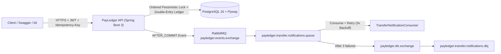

# PayLedger — Digital Wallet & Immutable Financial Ledger API

A production-oriented digital wallet and immutable double-entry ledger API built with **Java 21 + Spring Boot 3**, focused on **transactional consistency, idempotency, concurrency safety, resilient asynchronous messaging, and real-database integration testing with Testcontainers**.

---

## Architecture



---

## Key Engineering Decisions & Trade-offs

| Challenge | Decision | Why? |
| --- | --- | --- |
| **Monetary precision** | `BigDecimal` + `NUMERIC(19,2)` + `RoundingMode.HALF_EVEN` | Eliminates floating-point precision bugs (`double`/`float`) in financial calculations. |
| **Auditability vs. read speed** | `wallets` (current balance) + `ledger_entries` (immutable double-entry log) | Fast balance lookups combined with an append-only audit trail (`UPDATE`/`DELETE` never touch ledger history). |
| **Duplicate charges / network retries** | `Idempotency-Key` header + `UNIQUE` DB constraint | Retried requests return the original transaction without debiting or crediting twice. |
| **Race conditions & deadlocks** | `PESSIMISTIC_WRITE` (`SELECT ... FOR UPDATE`) ordered by ascending `UUID` | Prevents overspending under concurrency and eliminates deadlocks during simultaneous cross-transfers (`A -> B` and `B -> A`). |
| **Hibernate 1st-level cache staleness** | Scalar projection (`findIdByUserId`) before locking | Ensures the `Wallet` entity is only loaded into the Persistence Context *after* acquiring the pessimistic lock, always reading fresh balance and `@Version`. |
| **DB-to-Broker consistency** | `@TransactionalEventListener(phase = AFTER_COMMIT)` | Publishes RabbitMQ events only after PostgreSQL commits, avoiding ghost notifications on rollbacks. |
| **Notification resilience** | Exponential backoff retry (3 attempts) + Dead Letter Queue (DLQ) | External notification failures never block transfers or lose events. |
| **JPA performance** | `Persistable<UUID>` + `open-in-view: false` + `@EntityGraph` | Avoids extra `SELECT` before `INSERT` on pre-assigned UUIDs and eliminates N+1 queries on paginated statements. |
| **Standardized errors** | `@RestControllerAdvice` with RFC 7807 `ProblemDetail` | Predictable, machine-readable error contracts (`400`, `401`, `404`, `409`, `422`). |

---

## Tech Stack
- **Java 21** (Records, modern standard library) & **Spring Boot 3.4**
- **PostgreSQL 16** + **Flyway** (`ddl-auto: validate`)
- **Spring Security** + **JWT** (stateless, BCrypt)
- **RabbitMQ 3.13** (Direct Exchange, Exponential Backoff Retry, Dead Letter Queue)
- **Springdoc OpenAPI / Swagger UI**
- **JUnit 5**, **Mockito**, **Testcontainers**, and **k6**
- **Docker** (multi-stage build with non-root user) & **GitHub Actions CI**

---

## Running Locally

### 1. Start PostgreSQL and RabbitMQ
```bash
docker compose up -d
```

### 2. Run the application
```bash
mvn spring-boot:run
```

### 3. Access interactive UIs
- **Swagger UI:** http://localhost:8080/swagger-ui.html
- **Health Check:** http://localhost:8080/actuator/health
- **RabbitMQ Management:** http://localhost:15672 (user `payledger` / password `payledger_secret`)

---

## API Endpoints

| Method | Endpoint | Auth | Description |
| --- | --- | --- | --- |
| `POST` | `/api/v1/auth/register` | Public | Registers a user and provisions a wallet with `0.00` balance |
| `POST` | `/api/v1/auth/login` | Public | Authenticates user and returns a JWT |
| `GET` | `/api/v1/wallets/me` | JWT | Returns the authenticated user's wallet and balance |
| `POST` | `/api/v1/wallets/deposit` | JWT + `Idempotency-Key` | Credits funds and appends a `CREDIT` ledger entry |
| `POST` | `/api/v1/transfers` | JWT + `Idempotency-Key` | Transfers funds with deadlock-free locking and double-entry ledger |
| `GET` | `/api/v1/wallets/me/statement` | JWT | Paginated statement with optional filters (`direction`, `from`, `to`, `page`, `size`) |

---

## Testing & Verification

### Unit, Integration & Concurrency Tests (Testcontainers)
With Docker running:
```bash
mvn test
```
[PayLedgerIntegrationTest.java](src/test/java/com/payledger/PayLedgerIntegrationTest.java) spins up a real **PostgreSQL 16** container, runs Flyway migrations, and verifies:
- End-to-end flow (register → deposit → transfer → paginated statement)
- Idempotency under duplicate `Idempotency-Key` requests
- **High concurrency:** 10 simultaneous threads attempting to transfer `20.00` each from a wallet with `100.00` — proving exactly **5** succeed (`201`), **5** are rejected (`422`), and the balance never goes negative.

### Demonstrating Retry + DLQ in RabbitMQ
Send a transfer whose `description` contains `[FAIL_NOTIFICATION]`. The consumer retries 3 times with exponential backoff and automatically routes the intact JSON payload to `payledger.transfer.notifications.dlq`.

### Load Testing (k6)
With the API running locally and [k6](https://k6.io/) installed:
```bash
k6 run loadtest/transfer-load-test.js
```
